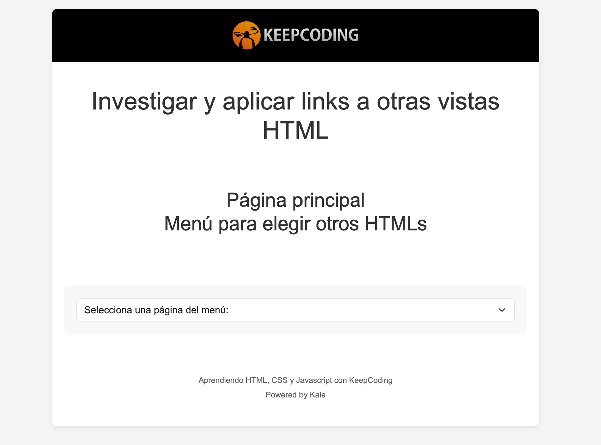
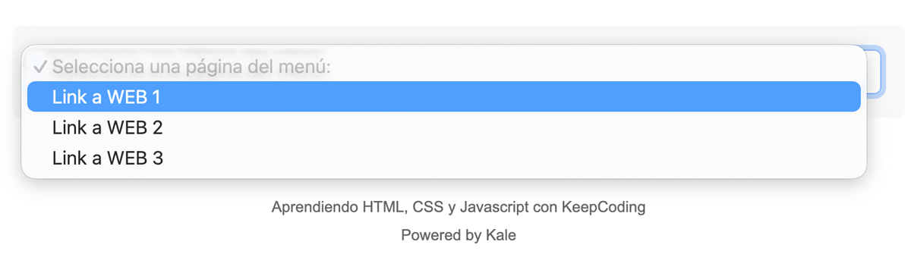
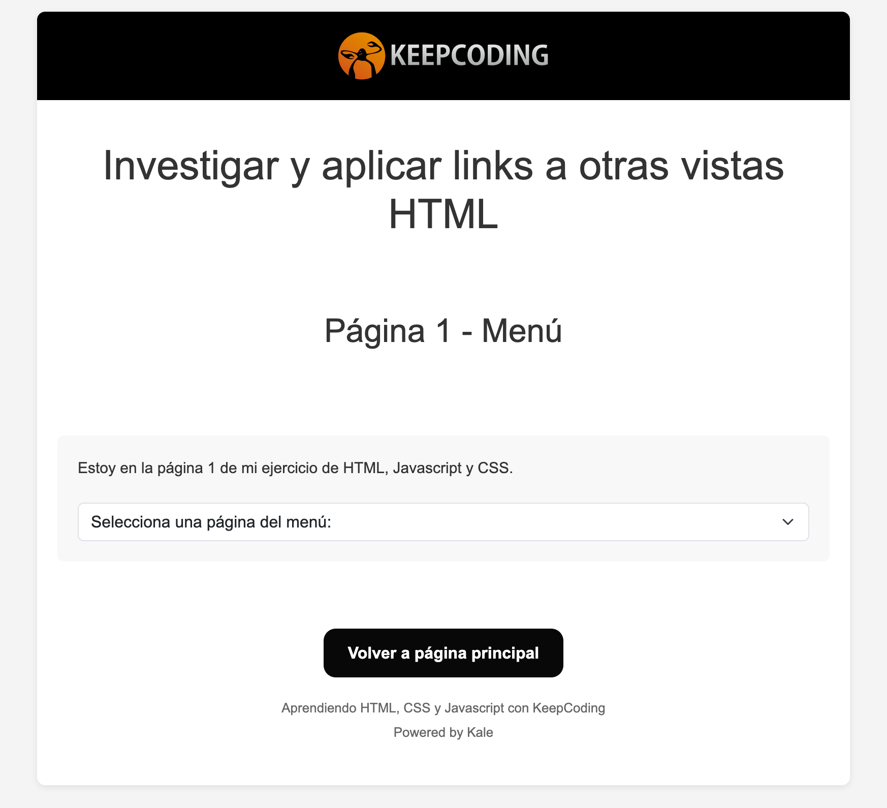

# Enlaces con HTML - Básico

Página principal "index.html" que tiene un menú con tres opciones a elegir y que llevan a otras páginas html. 

## Aspecto visual: 

. 

## Menú de opciones 

 

## Enlace a página 3 (ejemplo): 



## Detalles para ejecutar el index.html


## Instalación y Ejecución

1. Clona o descarga el repositorio en tu equipo.
2. Abre la carpeta del proyecto en Visual Studio Code para seguir practicando con HTML.
3. Crea y activa un entorno virtual:
   ```bash
    # Para crear el entorno: 
    # En Windows: 
    python -m venv entorno
    
    #Otra opción: 
    py -m venv entorno 

    # En MacOS: 
    python3 -m venv entorno

    # Para activar el entorno: 
    # En Windows:
    .\entorno\Scripts\activate

    # En macOS/Linux:
    source entorno/bin/activate
   ```
4. Instala las librerías necesarias ejecutando:
   ```bash
   # En Windows:
   pip install -r requirements.txt

   # En macOS/Linux:
   pip3 install -r requirements.txt
   ```

## Requerimientos
Necesitas un navegador como Firefox, Chrome.. para abrir el index.html desde la carpeta local.

## Licencia

Autor = Kale-Prada siguiendo el bootcamp "Programación cero" de Keepcoding España S.L.U.